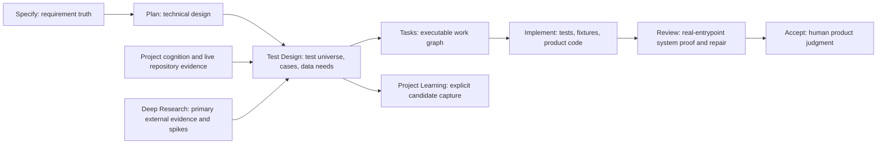

# Test Intelligence Workflow Proposal

**Status:** Accepted direction; Phase 1 shared contract implemented

**Scope:** Repository-wide and feature-scoped test design, test-material planning, evidence search, and downstream handoff

**Proposed public entrypoint:** `sp-test-design` / `spx-test-design`
**Non-goal:** Running or implementing the final test suite inside this workflow

## Executive Summary

Spec Kit Plus already has strong foundations for repository cognition, bounded
subagent work, implementation verification, integrated system review, evidence
storage, and human acceptance. The missing layer is a unified, reusable test
design contract that turns requirements, code, architecture, history, risks,
and existing verification routes into:

- a frozen and auditable Test Universe;
- a professional machine-readable test-case catalog with a deterministic human
  rendering;
- a test-data and test-material manifest;
- bidirectional traceability from obligation to test case, data, evidence,
  implementation task, Review scenario, and human acceptance;
- explicit gaps, exclusions, residual risks, and update triggers.

The product must not claim mathematically absolute test completeness. It can
make a stronger and more honest claim: **complete against a frozen, declared,
evidence-backed scope with zero unaccounted obligations**. Changed source,
unknown behavior, missing evidence, or unresolved high-risk gaps invalidate or
qualify that claim.

The recommended end state is one natural-language workflow entrypoint,
`sp-test-design` / `spx-test-design`, with inferred modes for project baseline,
active feature, incremental update, and catalog audit. Its outputs are planning
artifacts. `sp-tasks` remains the owner of executable work decomposition,
`sp-implement` remains the owner of test and fixture code, `sp-review` remains
the owner of real-entrypoint integrated proof and bounded repair, and
`sp-accept` remains the owner of human product acceptance.

## Existing Product Fit

The proposal builds on current product contracts rather than replacing them:

- Project cognition already supplies repository boundaries, capabilities,
  owners, consumers, verification routes, and minimal live-read guidance.
- `map-scan` already demonstrates runtime-owned packet preparation, lease,
  checkpoint, yield, acceptance, coverage accounting, and leader/subagent
  joins for repository-wide read-only analysis.
- `sp-tasks` already owns verification obligations, official entrypoints,
  system Review scenarios, human acceptance scenarios, and required evidence.
- The worker packet compiler already carries task checks, required validation,
  required evidence, consumer surfaces, and preservation obligations.
- `sp-review` already constructs an independent Review Universe and validates
  official real entrypoints using fresh integrated evidence.
- `sp-deep-research` already owns planning-critical external evidence and
  disposable proof lanes.
- The evidence runtime already stores content-addressed evidence records.
- Project Learning already supports compact intake and explicit capture without
  automatic promotion.

The current `templates/project-map/TESTING.md` is therefore a useful navigation
input, but it is not yet a complete test-case or test-data product.

## Workflow Ownership Boundary



`sp-test-design` may prepare safe workflow-local synthetic samples and evidence
objects, but it must not silently edit product source, test source, migrations,
build configuration, or repository fixture directories. Materializing those
assets into executable repository surfaces belongs to `sp-tasks -> sp-implement`.

## Product Trio Ideation

### Product Manager Perspective

1. **Project Test Baseline** — create a repository-wide, risk-ranked Test
   Universe and reveal verification debt before feature work begins.
2. **Feature Test Contract** — derive test obligations from an approved spec and
   plan before task generation so omissions are cheaper to repair.
3. **Incremental Test Update** — re-evaluate only capabilities and contracts
   affected by a source or planning diff while preserving stable IDs.
4. **Coverage Debt Register** — make exclusions, deferrals, missing harnesses,
   residual risk, owners, and revisit conditions visible and actionable.
5. **Reusable Test Packs** — allow validated cases, data recipes, and evidence
   patterns to be reused across features without copying stale prose.

### Product Designer Perspective

1. **One Intent-Driven Entrypoint** — infer project baseline, feature, update, or
   audit mode from natural language and current workflow state.
2. **Scope Preview Before Work** — show the frozen sources, risk dimensions,
   planned lanes, exclusions, and expected outputs before broad scanning.
3. **Progressive Test Views** — provide a compact readiness summary, a coverage
   matrix for reviewers, and on-demand detailed cases rather than one huge file.
4. **Guided Material Decisions** — for each data need, clearly present reuse,
   generate, search, or human-provided choices with privacy and licensing impact.
5. **Resumable Gap Guidance** — every blocker explains the exact missing input,
   safe next action, observable unblock condition, and resume point.

### Software Engineer Perspective

1. **Runtime-Owned Schemas and Rendering** — make JSON the canonical source and
   deterministically render Markdown, rather than asking agents to reproduce a
   large template.
2. **Cognition-Driven Packetization** — partition work by capability, risk, and
   consumer chain instead of blindly splitting directories.
3. **Deterministic Test Data Recipes** — bind generated data to schemas, seeds,
   distributions, checksums, sanitization policy, and cleanup behavior.
4. **Independent Completeness Audit** — use a separate read-only audit wave to
   find omissions, contradictions, duplicate cases, weak oracles, and infeasible
   tests before the leader closes the workflow.
5. **Downstream Contract Compilation** — compile approved cases and data needs
   into `sp-tasks`, Review scenarios, acceptance scenarios, and worker packets
   without duplicating their state machines.

## Prioritized Product Ideas

### 1. Unified Test Universe and Traceability Graph

Create an explicit universe of test obligations drawn from requirements,
capabilities, public contracts, state transitions, user journeys, risks,
existing tests, historical regressions, and operational constraints.

Why selected:

- It is the foundation for any defensible completeness claim.
- It connects the currently separate strengths of Tasks, Review, Acceptance,
  Deep Research, evidence storage, and project cognition.
- It makes omissions visible before test implementation.

Assumptions to validate:

- Stable source IDs can be preserved across incremental updates.
- The current project graph exposes enough owner, consumer, and verification
  routes to reduce broad live reads without becoming the source of truth.
- Existing task and Review contracts can consume pointer-based handoffs.

### 2. One `sp-test-design` / `spx-test-design` Workflow

Expose one planning-only entrypoint with inferred modes:

- `project-baseline` for an existing repository;
- `feature` after `sp-plan` and before `sp-tasks`;
- `incremental-update` after source, contract, or risk changes;
- `audit` for an existing test catalog.

Why selected:

- One entrypoint avoids proliferating `scan`, `build`, `data`, and `audit`
  commands whose state ownership would be difficult to explain.
- The name distinguishes test design from actually running tests.
- It supports brownfield repositories without forcing a feature workflow.

Assumptions to validate:

- Users understand that test implementation and execution remain downstream.
- Natural-language routing can select scope without silently retargeting active
  feature work.
- A project-level artifact root and a feature-level artifact root can share one
  schema and lifecycle.

### 3. Leader and Bounded Subagent Evidence Pipeline

Use the advanced model as leader and delegate independent read-only discovery
lanes to the lowest-cost capable workers. The runtime owns packet state,
checkpoints, acceptance, and remaining work.

Why selected:

- Repository-wide test discovery is naturally parallel and evidence-heavy.
- The repository already has a proven packet/lease/checkpoint/join pattern.
- Worker results can remain proposals while the leader owns conflicts and final
  coverage claims.

Assumptions to validate:

- Test lanes can be partitioned with non-overlapping canonical write scopes.
- Capability/risk-based packets outperform directory-only packets.
- Native subagents cover most runs; durable `sp-teams` is needed only for large,
  multi-wave, or cross-session jobs.

### 4. Test Data and Evidence Packs

Treat data, fixtures, golden files, reference vectors, environment requirements,
and authoritative external sources as first-class, provenance-bound assets.

Why selected:

- A case without resolvable data and a trustworthy oracle is not execution-ready.
- Existing fixtures are local conventions rather than one reusable contract.
- Privacy, licensing, reproducibility, and cleanup need deterministic gates.

Assumptions to validate:

- Workflow-local generated samples can remain planning artifacts until Tasks and
  Implement materialize them into repository fixtures.
- Primary-source test vectors and public datasets can be imported through the
  existing content-addressed evidence store.
- Sensitive or production-derived data must remain an explicit human boundary.

### 5. Risk-Based Incremental Audit and Downstream Handoff

Fingerprint the frozen Test Universe, invalidate only affected rows on change,
then send pointer-only handoffs to Tasks and Review.

Why selected:

- A full rescan on every change will be too expensive for large repositories.
- Stable IDs and explicit invalidation make the catalog maintainable.
- Independent Review discovery prevents a test-design omission from silently
  narrowing final system validation.

Assumptions to validate:

- Cognition change propagation and live Git diff can identify a safe impacted
  subset.
- Source fingerprints and evidence digests are sufficient to reject stale cases.
- The handoff can be additive without changing the mandatory
  `tasks -> implement -> review -> accept` delivery chain.

## Recommended Workflow

### Stage 0: Resolve and Freeze Scope

The leader determines whether the request targets the whole project, one active
feature, a diff, or an existing catalog. It records:

- authoritative source refs and revision/fingerprint;
- included capabilities, modules, entrypoints, and environments;
- exclusions and policy-confirmed boundaries;
- risk profile and applicable test dimensions;
- current catalog revision, if any.

No worker is dispatched before this boundary is explicit.

### Stage 1: Project Cognition and Learning Intake

Use Project Learning through `learning start -> list -> show` and use project
cognition as the default navigation layer. A new cognition intent such as
`test_design` should return relevant capabilities, owners, consumers, test
surfaces, fixtures, official entrypoints, risk hotspots, historical regressions,
and minimal live reads.

Graph claims are route candidates. The leader and workers verify them against
live requirements, code, tests, configuration, schemas, runtime output, and
authoritative documentation.

### Stage 2: Compile the Test Universe

Create stable `TO-###` obligations from applicable sources:

- functional requirements and acceptance criteria;
- capability operations and consumer chains;
- API, schema, event, file-format, CLI, UI/TUI, and integration contracts;
- state transitions, permissions, tenant boundaries, and data invariants;
- failure, timeout, retry, idempotency, rollback, and recovery behavior;
- migration, compatibility, configuration, installation, and upgrade behavior;
- security, privacy, accessibility, internationalization, performance,
  resilience, observability, and operations obligations;
- historical defects and regression-sensitive areas;
- mandatory policy and constitution obligations.

Every applicable row receives a risk tier and required evidence class. A row
cannot disappear merely because no existing test or harness covers it.

### Stage 3: Prepare and Dispatch Discovery Lanes

The runtime partitions the universe by capability, owner, consumer chain, and
risk. Suggested dynamic lanes include:

- requirements and traceability;
- API, contract, and integration surfaces;
- state, storage, migration, and consistency;
- authentication, authorization, security, privacy, and abuse;
- UI, accessibility, responsive behavior, and internationalization;
- resilience, performance, compatibility, operations, and observability;
- existing test infrastructure, fixtures, CI, and smallest trustworthy checks;
- Git history, incident patterns, and regression evidence;
- external standards, official test vectors, and data-material research.

Workers receive bounded paths, authoritative refs, requested obligation IDs,
expected result shape, and explicit stop conditions. They submit candidate
cases, data needs, evidence, contradictions, and unresolved gaps. They do not
mutate canonical workflow state or claim coverage complete.

### Stage 4: Leader Join and Case Synthesis

The leader validates each packet, rejects unsupported claims, reconciles
conflicts, deduplicates overlapping cases, and converts accepted proposals into
canonical `TC-###` cases. Cases should be layered rather than inflated: one
behavioral obligation may map to unit, contract, integration, system Review,
and human acceptance evidence only where each layer adds distinct proof.

### Stage 5: Test Material Decision

For every unresolved `TD-###` data requirement, select exactly one disposition:

1. **Reuse** an existing verified fixture, example, factory, seed, golden file,
   or official reference vector.
2. **Generate** deterministic synthetic data from a schema, seed, constraints,
   distributions, edge partitions, and cleanup recipe.
3. **Search** primary official documentation, standards, reference
   implementations, or licensed public datasets and import provenance-bound
   evidence.
4. **Request** an explicitly authorized human-provided resource when hardware,
   credentials, licensed data, or sensitive inputs cannot be safely synthesized.
5. **Block or defer** with owner, affected cases, residual risk, exact unblock
   criteria, and resume point.

Real customer or production data is rejected by default. Any captured sample
requires explicit authorization, sanitization proof, minimum retention, access
classification, and a non-production target.

### Stage 6: Independent Audit Wave

A separate read-only auditor receives the frozen universe, catalog, data
manifest, and coverage matrix. It looks specifically for:

- uncovered or silently downgraded obligations;
- missing negative, boundary, state-transition, permission, concurrency,
  rollback, recovery, and compatibility variants;
- weak or circular expected results;
- cases that cannot be executed from a known entrypoint or harness;
- missing, stale, unsafe, unlicensed, or irreproducible test data;
- duplicate or contradictory cases;
- test-layer inflation and brittle implementation-coupled cases;
- gaps between automated Review and human acceptance.

The leader owns all repairs and the final decision.

### Stage 7: Validate and Hand Off

The runtime validates schemas, source freshness, bidirectional traceability,
data hygiene, evidence freshness, and completeness status. It then emits a
pointer-only handoff:

- `sp-tasks` consumes approved test obligations and creates implementation work;
- `sp-implement` writes or updates executable tests, factories, fixtures, and
  harness wiring;
- `sp-review` consumes system scenarios but still performs independent coverage
  discovery and fresh real-entrypoint validation;
- `sp-accept` consumes selected human-observable journeys;
- `sp-deep-research` owns unresolved external feasibility, normative oracles,
  and disposable proof work.

## Leader and Subagent Contract

### Leader Owns

- scope, source revision, risk model, and workflow authorization;
- canonical Test Universe, catalog, manifests, and state transitions;
- lane preparation, assignment, acceptance, and remaining-work calculation;
- conflict resolution, deduplication, gap classification, and exception policy;
- data privacy/licensing decisions and external-source acceptance;
- independent audit join and final completeness claim;
- pointer-only downstream handoff.

### Worker Owns

- only the assigned paths, obligations, and evidence questions;
- live evidence inspection within the packet boundary;
- candidate cases, data needs, contradictions, confidence, and unknowns;
- packet-local checkpoints and structured result submission;
- early yield when scope exceeds capacity or evidence is insufficient.

Workers never author global queue/state, accept their own packet, expand scope,
or declare the catalog complete.

### Native vs Durable Collaboration

Use native in-session subagents by default. Use `sp-teams` only when the scan is
large enough to need cross-session durability, explicit long-running join
points, isolated workspaces, or lifecycle recovery beyond one subagent burst.

## Canonical Artifacts

Recommended roots:

- project baseline: `.specify/test-design/`;
- active feature: `<FEATURE_DIR>/test-design/`.

Recommended artifacts:

| Artifact | Owner | Purpose |
|---|---|---|
| `test-state.json` | runtime | resumable state, revision, cursor, blockers, claim status |
| `test-universe.json` | runtime + leader evidence | frozen `TO-###` obligations and risk/applicability |
| `test-catalog.json` | runtime | canonical `TC-###` cases |
| `test-catalog.md` | deterministic renderer | readable view, never the source of truth |
| `test-data-manifest.json` | runtime | canonical `TD-###` datasets, recipes, provenance, hygiene |
| `coverage-matrix.json` | runtime | bidirectional obligation/case/data/evidence/downstream mapping |
| `test-gaps.json` | runtime | blocked, deferred, excluded, unknown, and residual-risk rows |
| `lane-manifest.json` | runtime | only present when lanes are actually delegated |
| `lane-results/` | runtime | one accepted structured result per delegated lane |
| `handoff-to-tasks.json` | runtime | compact pointer-only downstream transition |

Stable shapes belong in schemas, templates, renderers, and runtime code. Agents
fill semantic content; they do not reconstruct long JSON or Markdown boilerplate.

## Professional Test Case Contract

Each `TC-###` should include at least:

| Group | Fields |
|---|---|
| Identity | `case_id`, title, objective, status, priority, risk tags |
| Traceability | source refs, `TO-###` refs, capability refs, task refs, entrypoint refs |
| Classification | level, test type, automation target, owner stage, environment |
| Setup | preconditions, roles/permissions, configuration, `TD-###` data refs |
| Procedure | ordered actions or generated/property contract |
| Oracle | expected result per step, invariants, pass/fail criteria, observable evidence |
| Variants | positive, negative, boundary, state, concurrency, timing, recovery, compatibility |
| Isolation | cleanup/reset, idempotency, side-effect boundary, shared-resource constraints |
| Evidence | required evidence kinds, fingerprint/snapshot binding, freshness rule |
| Lifecycle | flake risks, residual risk on skip, invalidation triggers, last validated revision |

Not every dimension is applicable to every case. Applicability and justified
`not_applicable` dispositions are explicit; omission is not equivalent to
`not_applicable`.

## Test Data and Material Contract

Each `TD-###` should record:

- name, kind, format, schema, volume, relationships, and constraints;
- source disposition: reused, generated, imported, captured, or human-provided;
- generator recipe, fixed seed, distribution, edge partitions, and checksum;
- provenance URL/path, source tier, license, retrieved version/date, and limits;
- sensitivity, PII/secret classification, sanitization proof, and allowed usage;
- applicable `TC-###` and downstream scenario IDs;
- environment and snapshot binding;
- refresh, retention, cleanup/reset, and deletion behavior;
- expected oracle or golden-result binding;
- unresolved limitations and residual risk.

## Completeness and Quality Gates

### Completeness Vocabulary

Allowed terminal claims:

- `complete_against_frozen_scope`: all applicable obligations are accounted for,
  all required links and materials are valid, no blocking gap remains, and the
  source fingerprint is current;
- `qualified_with_declared_gaps`: nonblocking gaps or confirmed exclusions have
  owners, impact, evidence expectations, residual risk, and revisit conditions;
- `blocked`: one or more required high-risk obligations, sources, or materials
  cannot be safely resolved;
- `stale`: authoritative sources or the scoped repository fingerprint changed.

Never emit `absolutely_complete` or infer completeness from a raw count of cases.

### Required Gates

1. **Boundary gate** — exact sources, revision, included scope, exclusions, and
   risk model are frozen.
2. **Schema gate** — state, universe, catalog, data, matrix, gaps, and handoff
   conform to runtime-owned schemas.
3. **Bidirectional traceability gate** — every applicable `TO-###` maps to a
   case or justified disposition; every case maps back to authoritative truth.
4. **Scenario-dimension gate** — applicable positive, negative, boundary, state,
   permission, concurrency, recovery, compatibility, and non-functional
   dimensions are covered or explicitly disposed.
5. **Oracle gate** — every case has a non-circular, observable expected result.
6. **Feasibility gate** — every case has a known level, harness/entrypoint,
   owner stage, data source, evidence shape, and side-effect boundary.
7. **Data hygiene gate** — provenance, license, sensitivity, reproducibility,
   retention, sanitization, and cleanup rules pass.
8. **Evidence freshness gate** — source/evidence fingerprints match the current
   universe and cannot close a later revision or Review cycle.
9. **Independent audit gate** — audit findings are joined, resolved, deferred
   through policy, or explicitly blocking.
10. **Downstream gate** — Tasks and Review receive complete pointer-based
    contracts without reauthoring stable test truth as prose.

## Suggested Runtime Surface

The exact state machine should live under one namespace, for example:

```text
specify-runtime test-design init
specify-runtime test-design status
specify-runtime test-design universe-build
specify-runtime test-design lane-prepare
specify-runtime test-design lane-lease
specify-runtime test-design lane-checkpoint
specify-runtime test-design lane-yield
specify-runtime test-design lane-accept
specify-runtime test-design synthesize
specify-runtime test-design audit-prepare
specify-runtime test-design validate
specify-runtime test-design handoff
```

The runtime should generate packets, result skeletons, IDs, indexes, rendered
Markdown, and completeness calculations. It should reject hand-authored global
state and stale packet results.

## Cross-Profile and Cross-CLI Impact

This is a shared product change, not a Codex-only extension.

If the public command is introduced, update at least:

- Classic command, command references, worker prompt, and artifact templates;
- Advanced `spx-test-design` skill, triggered references, assets, and
  `_shared/surface-map.json`;
- workflow/artifact registries, runtime schemas, CLI/API surfaces, and packaging;
- `sp-tasks`, packet compiler, `sp-review`, and acceptance consumers;
- all skills-based and command-based integration rendering;
- README, Project Handbook, Start Here routing, and profile topology tests;
- Classic/Advanced equivalence and structured handoff regression tests.

The workflow registry should classify test design as planning-only and
`no_closeout` with respect to project cognition because it does not mutate
product source. Actual test/fixture changes made later by Implement remain
subject to the existing cognition mutation closeout.

## Delivery Strategy

### Phase 1: Shared Asset Contract Inside Tasks

- Implemented four canonical, schema-validated artifacts: `test-universe`,
  `test-catalog`, `test-data-manifest`, and `coverage-matrix`, with deterministic
  Markdown renderers. Initial gap dispositions live in coverage status; the
  dedicated resumable gap/state contract remains Phase 2 work.
- Registered feature-local `test-design/*.json` scaffolds as patch-only
  canonical artifacts that reject whole-file submit.
- Extended `sp-tasks` / `spx-tasks` to consume an optional authoritative
  test-design handoff and preserve task-local `test_case_refs` and
  `test_data_refs` through Python and Go JIT worker-packet compilation.
- Added schema, bidirectional traceability, data-hygiene, packaging,
  task-index-to-packet, and cross-runtime regression coverage.
- No public command is introduced in Phase 1; artifact authority is proven
  before adding another workflow state machine.

### Phase 2: Public Test Design Workflow

- Add `sp-test-design` / `spx-test-design` and project/feature artifact roots.
- Add cognition `test_design` intent and live-read routing.
- Add runtime-owned universe, lane, synthesis, audit, validation, and handoff
  state.
- Integrate Deep Research evidence routing and the content-addressed evidence
  store.

### Phase 3: Incremental and Durable Scale

- Add source-fingerprint invalidation and impact-based updates.
- Add durable `sp-teams` execution for large multi-wave repositories.
- Add quality metrics such as obligation accounting, executable readiness,
  stale evidence, deferred risk, and downstream implementation progress.
- Feed proven test-generation lessons into Project Learning through explicit
  review and promotion.

## Decisions Still Needing Validation

1. Should project-baseline artifacts live in `.specify/test-design/` or a
   registry-selected workflow root?
2. Which Test Universe dimensions are mandatory by default and which are
   activated only by risk/profile?
3. Can current cognition change propagation safely drive incremental test
   invalidation, or is a dedicated dependency index required?
4. Which workflow-local test materials may be generated before Implement, and
   which must remain recipes/evidence only?
5. How should existing feature `system_review_scenarios` and human acceptance
   scenarios reference `TC-###` without creating competing authority?
6. What minimum evidence is required before a case is marked
   implementation-ready?

## Recommendation

Phase 1 now establishes the shared schemas, renderers, validator, runtime
artifact governance, and Tasks consumer. Introduce the public
`sp-test-design` / `spx-test-design` workflow in Phase 2 once this artifact
authority has proved stable in real projects. This sequencing delivers immediate value while
avoiding a premature command family or a second verification state machine.

The core product promise should be:

> Turn the current project, its requirements, risks, history, and live evidence
> into a complete-against-scope, traceable, execution-ready test design and data
> pack—using leader-owned truth, bounded subagent discovery, deterministic
> artifacts, explicit unknowns, and downstream independent verification.
